# Rediseño «Naranja cálido» (noviembre de 2026)

Diseño aprobado en el lienzo de maquetas (Inicio, Agenda, Ficha, Buscador,
Pacientes, Historia, Historia guardada, Procedimientos, Caja, Inventario y
Ajustes). Se pasa a la aplicación por partes; cada parte cambia **cómo se
ve**, no **lo que hace**: los mismos campos, textos, validaciones, PDF y
flujos, para que las pruebas y los e2e sigan siendo la referencia.

## Principios

1. **Color con significado.** Naranja = marca y acciones. Verde = todo bien
   (completa, vigente, íntegra). Ámbar = atención (incompleta, refiere,
   por pedir). Carmesí = peligro (alergias, errores). Todo lo demás, neutro
   cálido. El carmesí se alejó del rojo anterior para no confundirse con el
   naranja.
2. **Nada solo por color.** Cada estado lleva además texto o ícono
   («Completa», «Incompleta», candado, ⚠).
3. **Contraste AA.** El naranja de marca (#F54927, 3,6:1) se usa en el logo,
   barras de avance y acentos; los botones, enlaces y foco usan un naranja
   más hondo (#C93C1F, 5,1:1 sobre blanco y 4,6:1 sobre el tinte).
4. **Formas suaves.** Tarjetas de 20 px de radio con sombra cálida, campos
   de 12 px y botones en píldora.

## Paleta (`lib/app/tema.dart`, `ColoresMarca`)

| Uso | Token | Color | Contraste sobre blanco |
|---|---|---|---|
| Marca, acentos | `marca` | #F54927 | 3,6:1 (no para texto pequeño) |
| Botones, enlaces, foco | `primario` | #C93C1F | 5,1:1 |
| Texto principal | `tinta` | #2B211D | 15,7:1 |
| Etiquetas | `tintaSuave` | #574A44 | 8,5:1 |
| Texto secundario | `textoSuave` | #6A5C55 | 6,4:1 |
| Ayudas | `pista` | #7A6B64 | 5,1:1 |
| Todo bien | `estadoOk` / `estadoOkFondo` | #1E6B3A / #E7F3EA | 6,5:1 |
| Atención | `aviso` / `avisoFondo` / `avisoTexto` | #8A5A0B / #FFF6DD / #5C3C06 | 5,9:1 |
| Peligro | `error` / `errorFondo` | #9B1C3A / #FCE7EC | 8:1 |
| Fondo de la app | `fondo` | #FAF6F3 | — |
| Selección | `tinte` / `tinteTexto` | #FEF1ED / #9F2F19 | 6,6:1 sobre el tinte |

La fuente sigue siendo Inter, incluida en el sitio (sin peticiones a
terceros).

## Partes

- **R1 · Tema y historia clínica** (PR #9, publicada). Paleta y formas en toda la
  aplicación. En la historia: número de cada sección en un círculo con el
  color de su estado; índice con avance («8 de 9 secciones completas») y el
  recuadro «Para finalizar falta» / «Lista para finalizar», cuyos datos
  llevan a su sección; franja del paciente con iniciales y la alergia en
  carmesí; revisión por sistemas con «Niega» en verde y «Refiere» en ámbar;
  firma y sello con la muestra «Así aparecerá al final del PDF». Los colores
  de la barra del navegador y del fondo de arranque pasan a la paleta nueva.
- **R2 · Logo, ilustraciones, menú, inicio y buscador** (PR #10, publicada).
  - **Logo naranja**: el mismo logo (cruz, pulso y hoja) con la cruz en
    #F54927 y el documento en #9F2F19. Íconos nuevos con otro nombre
    (`icons/logo-naranja-*.png`, para que los móviles no usen los viejos) y
    `favicon.ico`; dentro de la app, junto al nombre en la historia, el
    menú y el desbloqueo (`assets/marca/logo.png`).
  - **Ilustraciones** (`lib/core/widgets/ilustraciones.dart`): siete
    dibujos vectoriales en un solo estilo (mancha cálida, trazo de tinta,
    acentos naranjas), hechos en código, sin archivos ni conexión:
    consulta, agenda libre, sin resultados, candado, listo, caja e
    inventario. Van en el Inicio, el desbloqueo y los estados vacíos de la
    agenda, pacientes, caja, inventario y el buscador. Las tarjetas del
    consultorio llevan la sombra cálida y los recuadros de ícono, una
    forma más suave.
  - **Inicio** (`/inicio`, primero del riel y la pantalla con la que abre;
    antes abría en la agenda): saludo, el **siguiente paciente** con sus
    alergias en carmesí, el estado de la cita, «Empezar consulta» (lo
    mismo que «Atender» en la agenda) y «Ver ficha»; las citas que siguen;
    lo pendiente (controles vencidos, recordatorios de mañana, lotes
    vencidos o por vencer, insumos bajo el mínimo), y el día en números.
    En el modo presentación no muestra montos ni el motivo de la cita.
  - **Menú**: en el riel, «Buscar» y «Nueva consulta» (la historia en
    blanco; si la que está en curso tiene cambios, pregunta antes). En el
    menú del teléfono, el logo, los dos botones y los grupos *Consulta*,
    *Consultorio* y *Ajustes*. La «Historia» sigue en el menú.
  - **Buscador** (Ctrl + K o ⌘ + K, o el botón): pacientes por nombre o
    documento sin tildes, con «Consulta», «Cita» y «Cobrar», y las
    pantallas («Ir a Caja»). ↑ ↓ para moverse y Enter para abrir la ficha.
  - **Inventario: «Eliminar»** en cada insumo. Sin lotes ni movimientos se
    borra; con historia (entradas, sesiones o cobros) se guarda oculto e
    inactivo para no perder la trazabilidad: deja de verse, de sugerirse y
    de alertar, pero las historias, los recibos y los informes que lo
    nombran no cambian. Queda en la bitácora.
- **R3 · Resto del consultorio (esta parte).** Misma conducta y textos;
  cambia cómo se ve.
  - **Agenda**: sin colores por tipo de cita (cada tipo conserva su ícono
    y su nombre); la siguiente cita por atender lleva franja naranja y
    fondo con tinte; «Atendida» en verde. En la semana, bloques neutros.
  - **Pacientes**: iniciales en un círculo (ámbar si el control está
    vencido), el nombre más fuerte y filas con bordes suaves.
  - **Procedimientos y plantillas**: cada una en su recuadro, con el
    nombre destacado (también las plantillas de documentos en Ajustes).
  - **Caja**: lo recaudado en grande, en una tarjeta oscura con su
    ilustración, antes de «Totales del día».
  - **Inventario**: una barra de existencias frente al mínimo (se llena
    con el doble del mínimo): ámbar por debajo, verde por encima.
  - **Ajustes**: arriba, «Tu consultorio» (nombre, especialidad y
    consultorio) con su ilustración y el acceso a «Datos del médico».

## Queda igual, a propósito

- **Los PDF** (historia, receta, documentos, recibos): conservan su diseño
  impreso; cambiarlos altera documentos que ya se entregan a pacientes.
- **Los botones de la barra superior de la historia**: mismos lugares y
  nombres, para no romper la costumbre ni los e2e.

## Capturas de R1

Tomadas por los e2e sobre la compilación de producción (consultorio
encendido, CSP en el HTML, sin conexión).

| | |
|---|---|
| 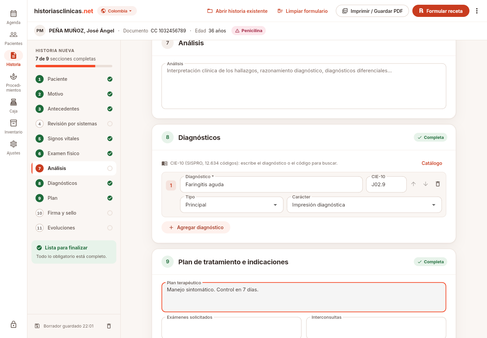 |  |
| Historia llena: índice con avance y «Lista para finalizar» | Al finalizar con datos faltantes |
|  |  |
| Firma y sello con la muestra del PDF | Historia abierta: secciones selladas |
| 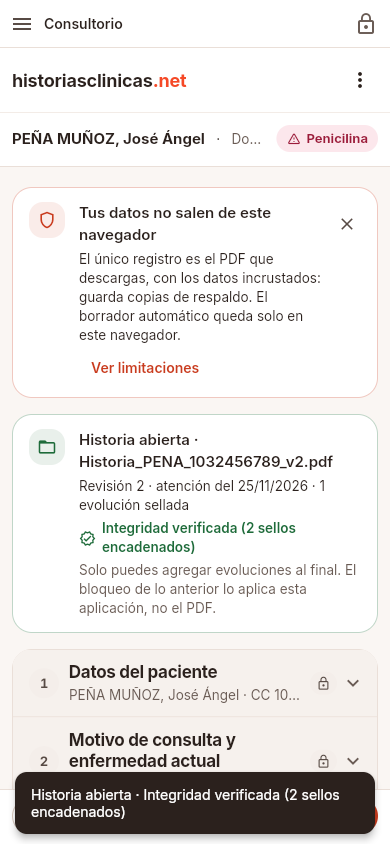 | 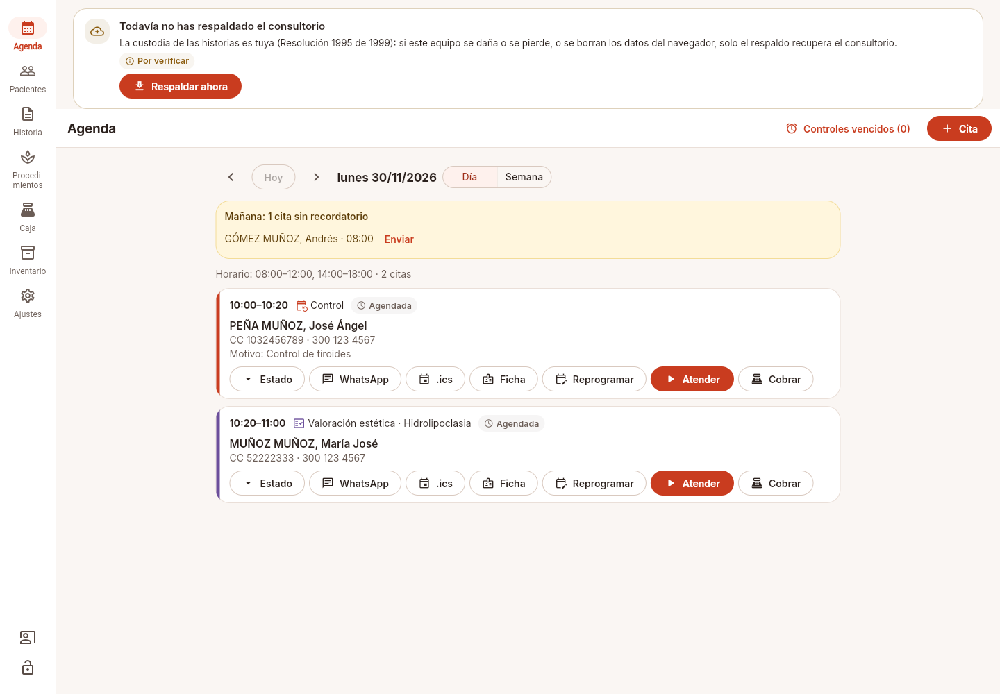 |
| Móvil | El tema llega solo al resto (agenda) |

## Capturas de R2

| | |
|---|---|
| 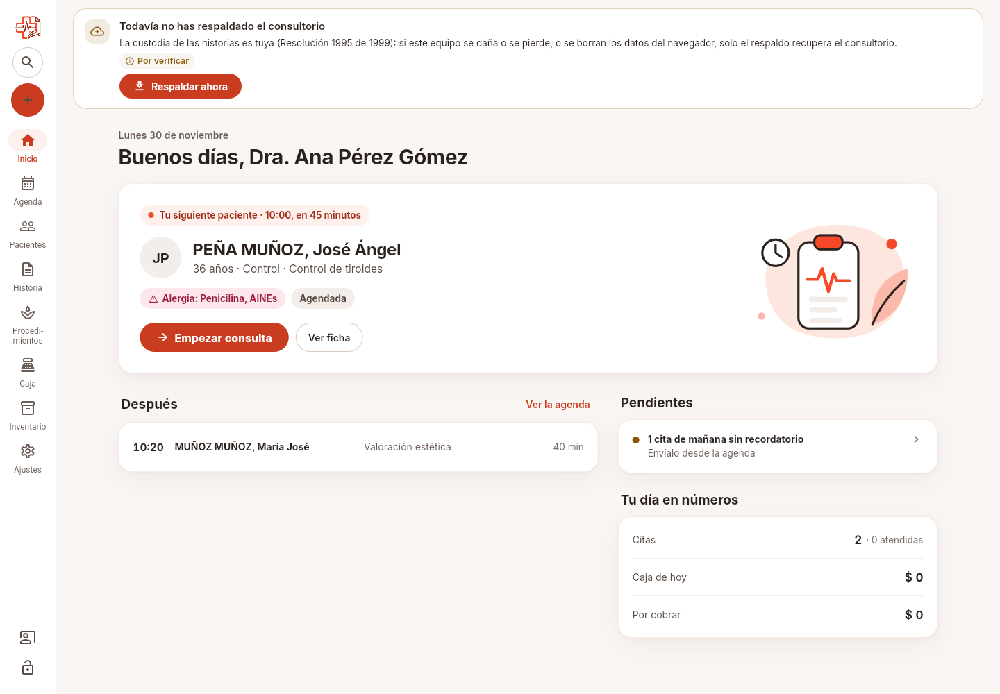 | 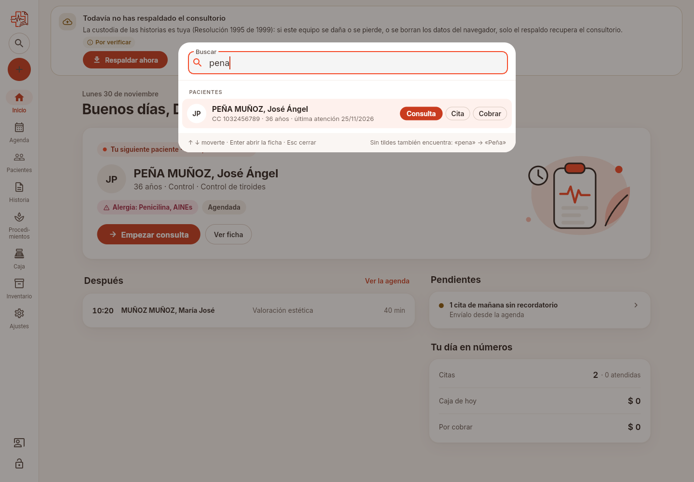 |
| Inicio: el siguiente paciente, después, pendientes y el día en números | Buscador (Ctrl + K): «pena» encuentra a PEÑA, con sus acciones |
| 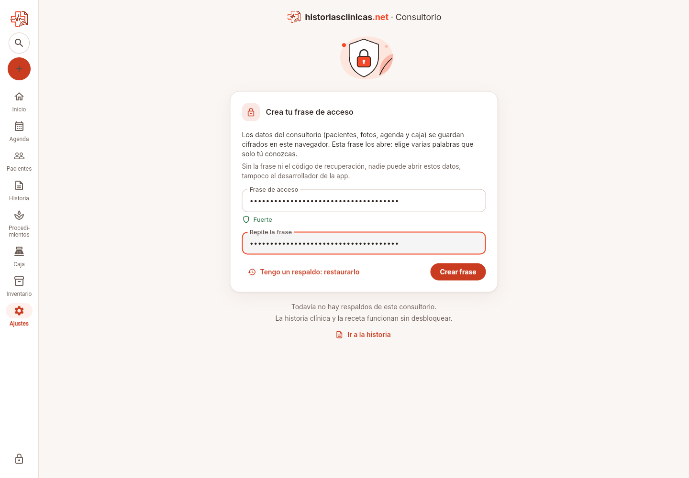 | 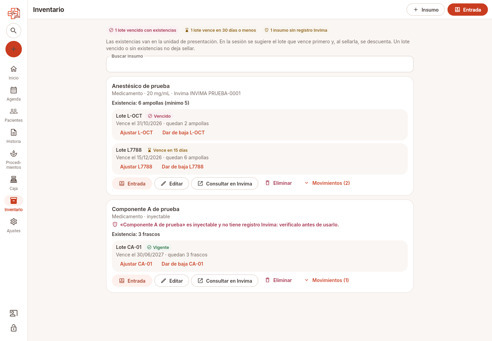 |
| Logo naranja e ilustración en el desbloqueo | «Eliminar» en cada insumo |
| 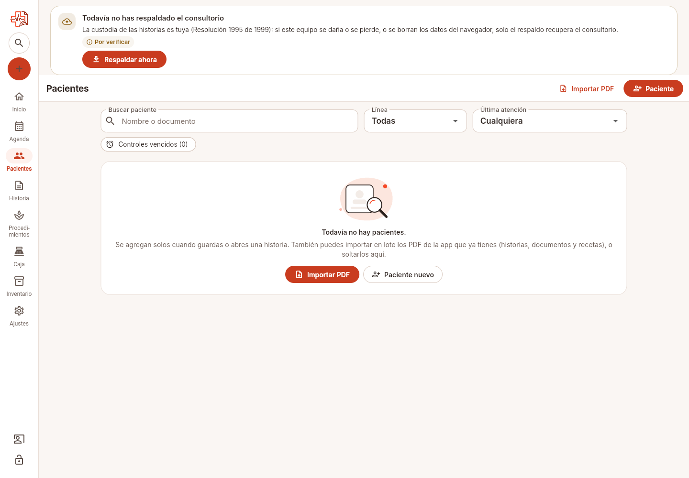 |  |
| Estado vacío con ilustración | El logo en naranja |

## Capturas de R3

| | |
|---|---|
| 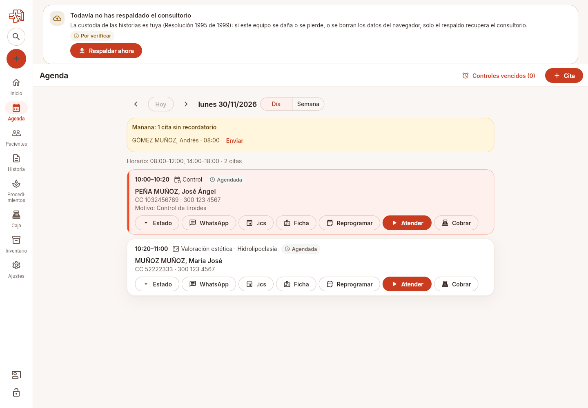 | 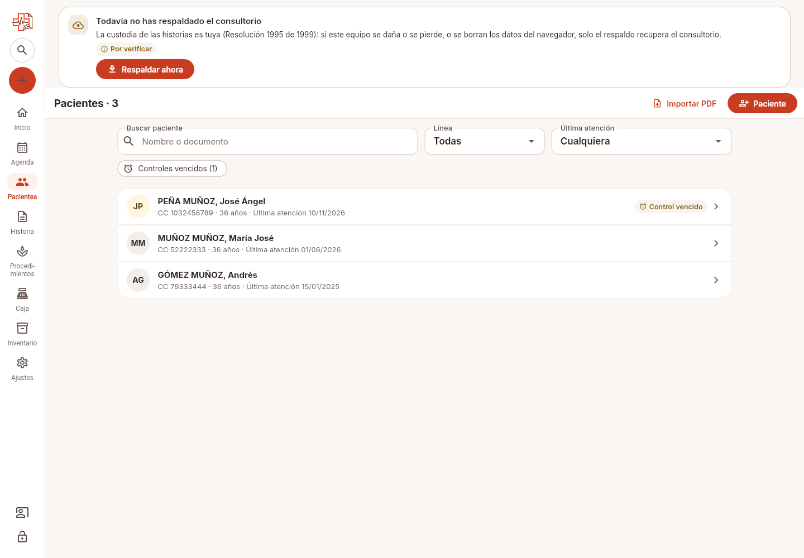 |
| Agenda: la siguiente cita resaltada, sin colores por tipo | Pacientes con iniciales (ámbar si el control está vencido) |
| 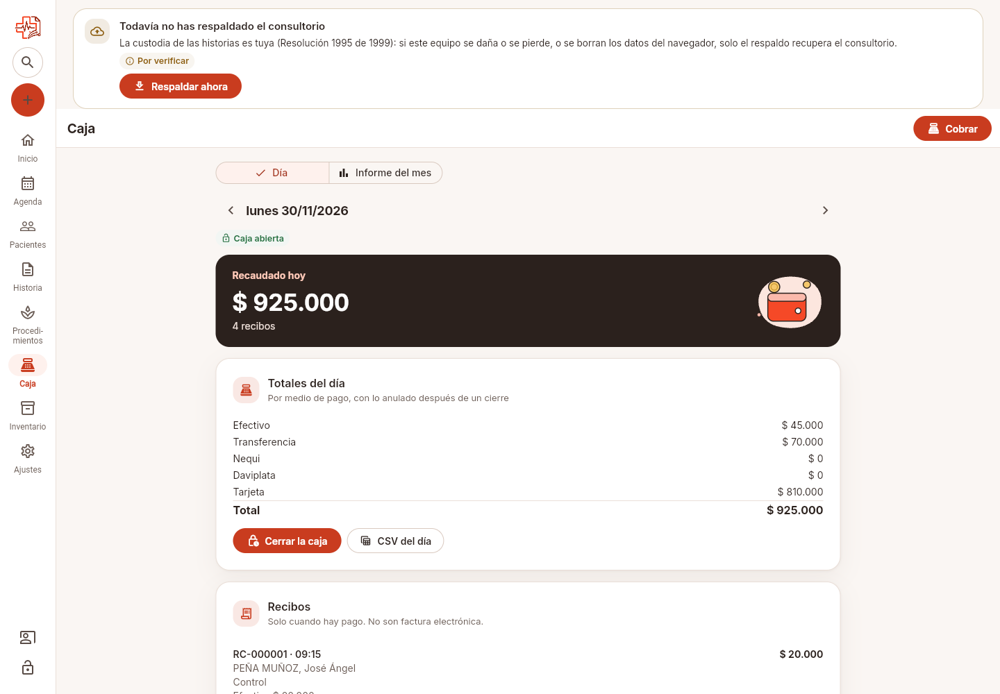 | 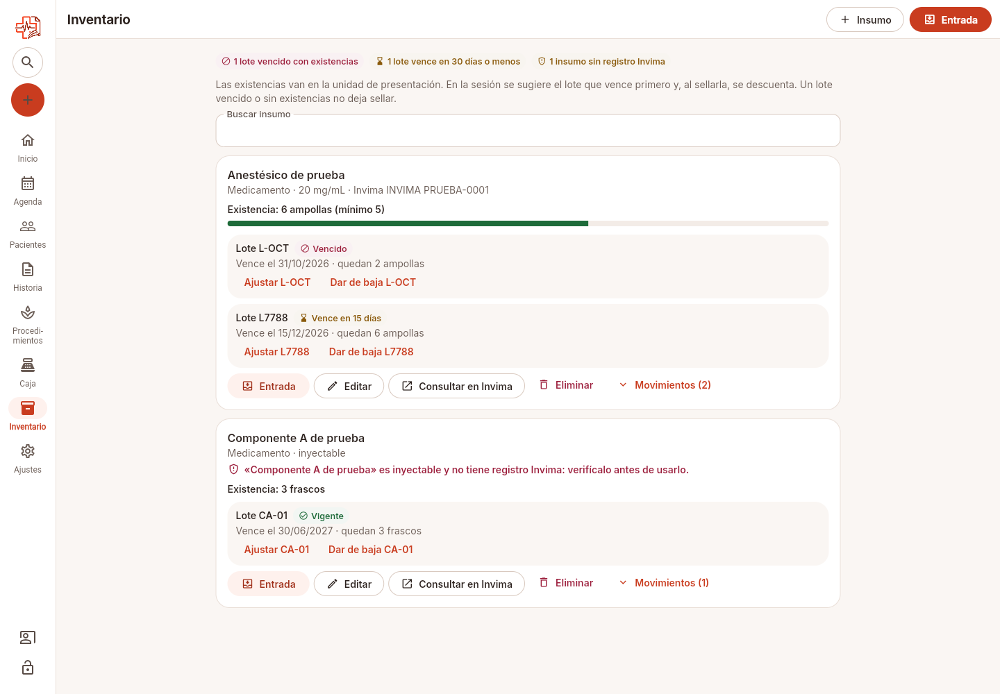 |
| Caja: lo recaudado en grande | Inventario: barra de existencias frente al mínimo |
| 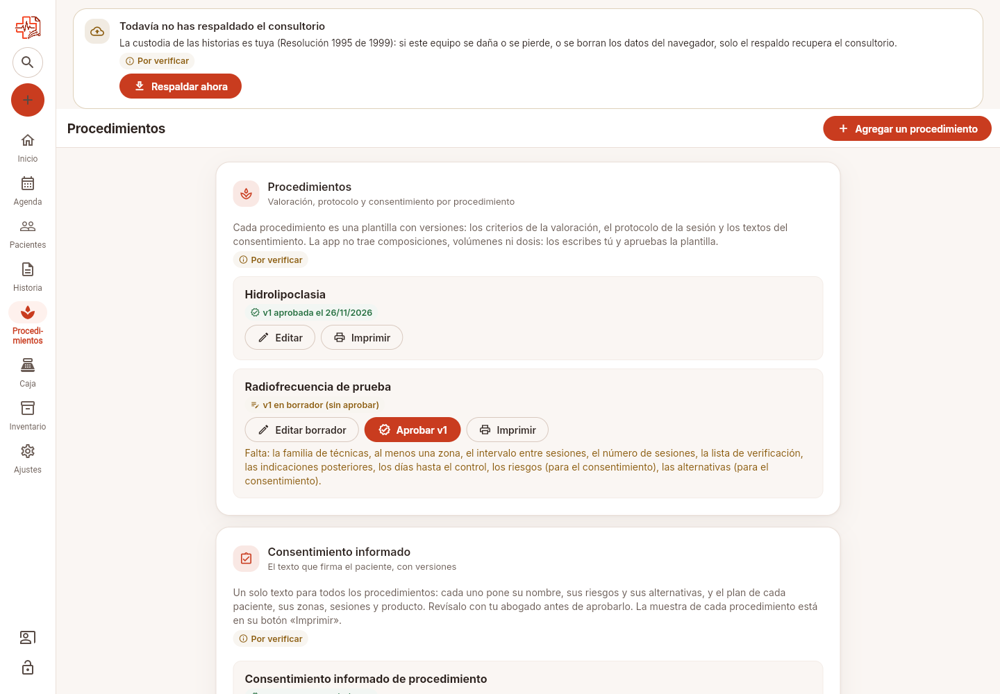 | 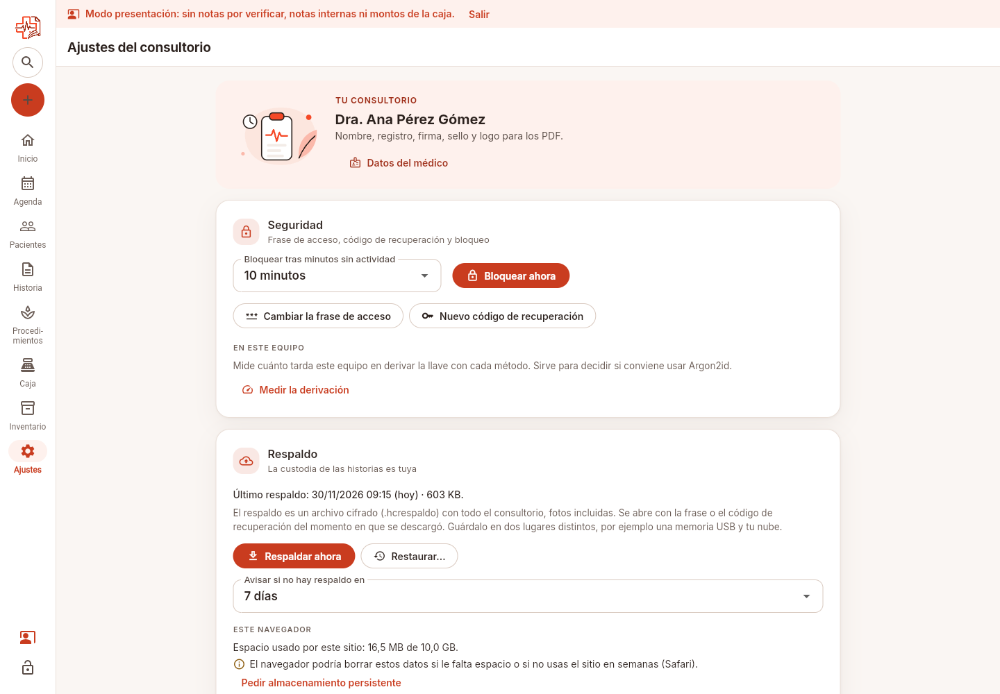 |
| Procedimientos, cada uno en su recuadro | Ajustes con «Tu consultorio» |
