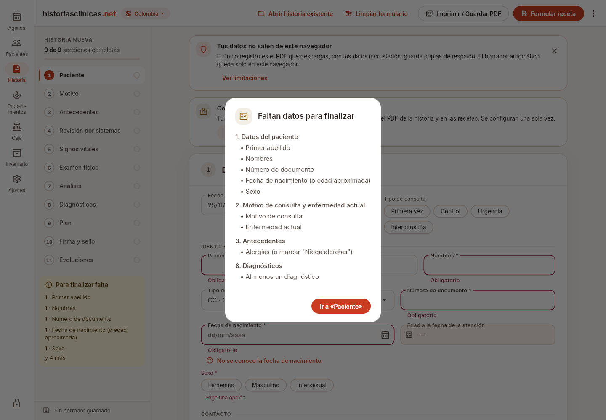
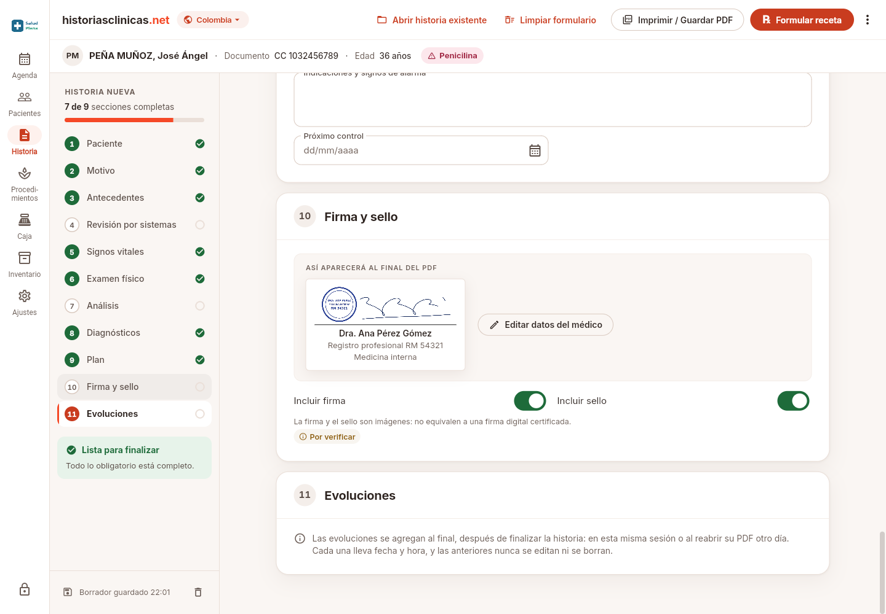
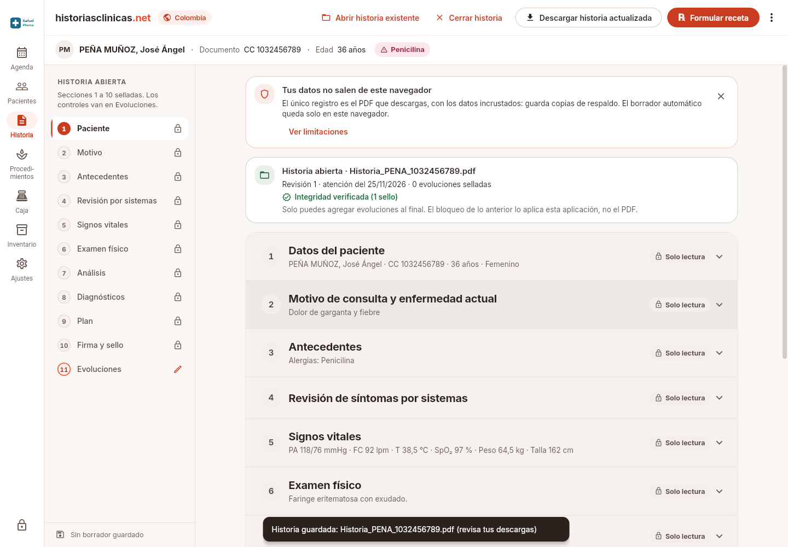

# Rediseño «Naranja cálido» (noviembre de 2026)

Diseño aprobado en el lienzo de maquetas (Inicio, Agenda, Ficha, Buscador,
Pacientes, Historia, Historia guardada, Procedimientos, Caja, Inventario y
Ajustes). Se pasa a la aplicación por partes; cada parte cambia **cómo se
ve**, no **lo que hace**: los mismos campos, textos, validaciones, PDF y
flujos, para que las pruebas y los e2e sigan siendo la referencia.

## Principios

1. **Color con significado.** Naranja = marca y acciones. Verde = todo bien
   (completa, vigente, íntegra). Ámbar = atención (incompleta, refiere,
   por pedir). Carmesí = peligro (alergias, errores). Todo lo demás, neutro
   cálido. El carmesí se alejó del rojo anterior para no confundirse con el
   naranja.
2. **Nada solo por color.** Cada estado lleva además texto o ícono
   («Completa», «Incompleta», candado, ⚠).
3. **Contraste AA.** El naranja de marca (#F54927, 3,6:1) se usa en el logo,
   barras de avance y acentos; los botones, enlaces y foco usan un naranja
   más hondo (#C93C1F, 5,1:1 sobre blanco y 4,6:1 sobre el tinte).
4. **Formas suaves.** Tarjetas de 20 px de radio con sombra cálida, campos
   de 12 px y botones en píldora.

## Paleta (`lib/app/tema.dart`, `ColoresMarca`)

| Uso | Token | Color | Contraste sobre blanco |
|---|---|---|---|
| Marca, acentos | `marca` | #F54927 | 3,6:1 (no para texto pequeño) |
| Botones, enlaces, foco | `primario` | #C93C1F | 5,1:1 |
| Texto principal | `tinta` | #2B211D | 15,7:1 |
| Etiquetas | `tintaSuave` | #574A44 | 8,5:1 |
| Texto secundario | `textoSuave` | #6A5C55 | 6,4:1 |
| Ayudas | `pista` | #7A6B64 | 5,1:1 |
| Todo bien | `estadoOk` / `estadoOkFondo` | #1E6B3A / #E7F3EA | 6,5:1 |
| Atención | `aviso` / `avisoFondo` / `avisoTexto` | #8A5A0B / #FFF6DD / #5C3C06 | 5,9:1 |
| Peligro | `error` / `errorFondo` | #9B1C3A / #FCE7EC | 8:1 |
| Fondo de la app | `fondo` | #FAF6F3 | — |
| Selección | `tinte` / `tinteTexto` | #FEF1ED / #9F2F19 | 6,6:1 sobre el tinte |

La fuente sigue siendo Inter, incluida en el sitio (sin peticiones a
terceros).

## Partes

- **R1 · Tema y historia clínica (esta parte).** Paleta y formas en toda la
  aplicación. En la historia: número de cada sección en un círculo con el
  color de su estado; índice con avance («8 de 9 secciones completas») y el
  recuadro «Para finalizar falta» / «Lista para finalizar», cuyos datos
  llevan a su sección; franja del paciente con iniciales y la alergia en
  carmesí; revisión por sistemas con «Niega» en verde y «Refiere» en ámbar;
  firma y sello con la muestra «Así aparecerá al final del PDF». Los colores
  de la barra del navegador y del fondo de arranque pasan a la paleta nueva.
- **R2 · Menú, inicio y buscador** (consultorio): menú agrupado con «Nueva
  consulta», inicio con el siguiente paciente y buscador con Ctrl + K.
- **R3 · Resto de pantallas del consultorio**: agenda sin colores por tipo,
  pacientes, procedimientos, caja, inventario y ajustes como en las maquetas.

## Queda igual, a propósito

- **El logo** (la cruz con el pulso y la hoja) y los íconos de la PWA. Si se
  quiere una versión naranja, se hace aparte.
- **Los PDF** (historia, receta, documentos, recibos): conservan su diseño
  impreso; cambiarlos altera documentos que ya se entregan a pacientes.
- **Los botones de la barra superior de la historia**: mismos lugares y
  nombres, para no romper la costumbre ni los e2e.

## Capturas de R1

Tomadas por los e2e sobre la compilación de producción (consultorio
encendido, CSP en el HTML, sin conexión).

| | |
|---|---|
|  |  |
| Historia llena: índice con avance y «Lista para finalizar» | Al finalizar con datos faltantes |
|  |  |
| Firma y sello con la muestra del PDF | Historia abierta: secciones selladas |
|  |  |
| Móvil | El tema llega solo al resto (agenda) |
